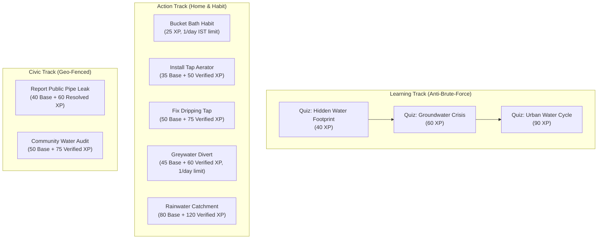
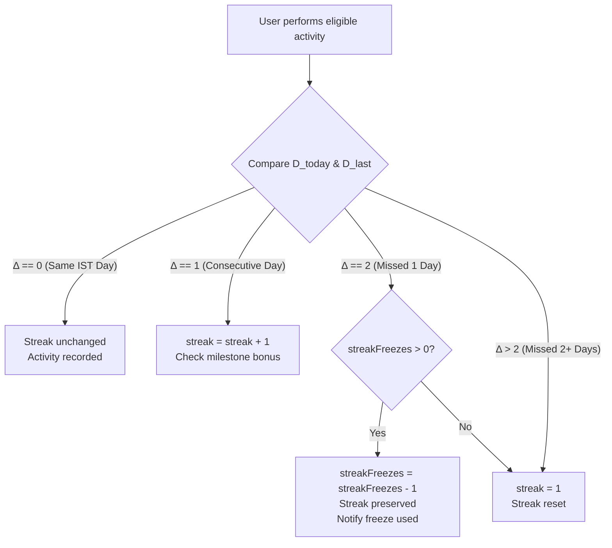
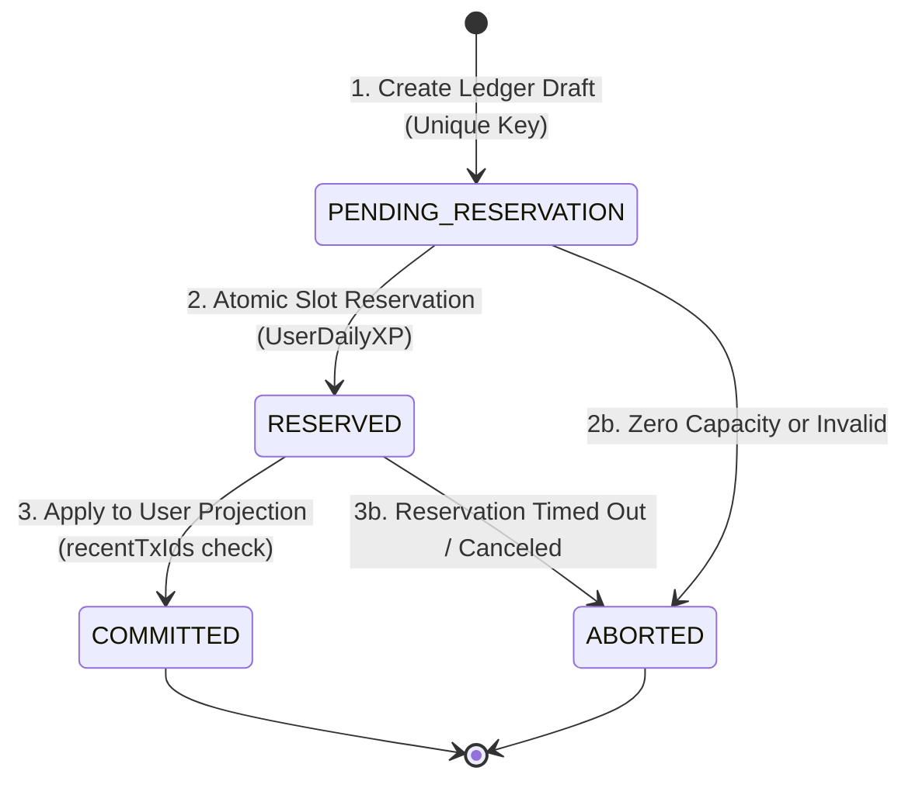

# AquaLoop — Game Economy & Progression Engine Specification

> **Status:** Specification Hardened & Consistency-Verified (Phase 3A) — Awaiting Final Phase 3B Approval  
> **Canonical Root:** `C:\Users\HP\OneDrive\Desktop\aquaLoop`  
> **Timezone Anchor:** `Asia/Kolkata` (UTC+05:30)  
> **Cost Guarantee:** ₹0 infrastructure cost; fully compatible with standalone local MongoDB Community Server and MongoDB Atlas M0.

---

## 1. Executive Summary & Design Principles

The AquaLoop game economy is designed to motivate real-world water conservation through achievable daily habits, verifiable conservation milestones, and community awareness.

### Core Tenets
1. **Absolute Server Authority:** XP, levels, badges, streaks, and verified impact metrics are computed, validated, and awarded **exclusively on the server**. The frontend acts as a rendering display and never transmits XP values or status claims.
2. **Impact Honesty & Data Transparency:** In compliance with workspace rules, user-reported metrics are never conflated with verified empirical savings. Every saved-water metric is strictly tagged as either `Self-Reported` or `Verified`.
3. **Crash-Consistent on Standalone MongoDB Without Replica Sets:** Standalone MongoDB Community Server does not support multi-document ACID transactions. The system achieves mathematical crash consistency and guarantees that balances are never double-incremented by treating the immutable `XPTransaction` ledger as the sole source of truth, managing daily caps via atomic single-document reservation slots, applying idempotent updates to user projections, and enforcing an explicit state-machine recovery protocol.
4. **Timezone Determinism:** All daily resets, streak rollover windows, and daily bonus cooldowns are explicitly anchored to Indian Standard Time (`Asia/Kolkata`, UTC+05:30), preventing time-shift exploits.

---

## 2. Approved Level Progression System (Decision D1)

AquaLoop uses a 4-tier milestone level curve. Progression is steady, encouraging early retention while making the top tier a meaningful civic distinction.

### 2.1 Level Tiers & Thresholds (Approved)

| Level | Tier Name | Cumulative XP Required | XP Span in Level | Description & Civic Role |
|:---:|:---|:---:|:---:|:---|
| **1** | **Droplet** | **0 – 499 XP** | 500 XP | Beginner explorer learning foundational household water awareness. |
| **2** | **Stream** | **500 – 1,499 XP** | 1,000 XP | Active conservationist consistently tracking daily savings habits. |
| **3** | **River** | **1,500 – 3,499 XP** | 2,000 XP | Community water advocate submitting verified actions and local civic reports. |
| **4** | **Ocean Guardian** | **3,500+ XP** | Master Tier | Top-tier guardian leading community efforts, audits, and regional impact. |

### 2.2 Mathematical Progression Formula

Given a user's total server-validated cumulative XP $X$:

$$\text{Level}(X) = \begin{cases} 
1 & \text{if } 0 \le X < 500 \\
2 & \text{if } 500 \le X < 1500 \\
3 & \text{if } 1500 \le X < 3500 \\
4 & \text{if } X \ge 3500 
\end{cases}$$

### 2.3 Progress Within Level (For UI XP Bar)

To compute the percentage filled in the UI `<XPBar>` component:

- **Level 1 (Droplet):**  
  $\text{XP}_{\text{current}} = X - 0$  
  $\text{XP}_{\text{required}} = 500$  
  $\text{Percentage} = \min\left(100, \left\lfloor \frac{\text{XP}_{\text{current}}}{500} \times 100 \right\rfloor\right)$

- **Level 2 (Stream):**  
  $\text{XP}_{\text{current}} = X - 500$  
  $\text{XP}_{\text{required}} = 1000$  
  $\text{Percentage} = \min\left(100, \left\lfloor \frac{\text{XP}_{\text{current}}}{1000} \times 100 \right\rfloor\right)$

- **Level 3 (River):**  
  $\text{XP}_{\text{current}} = X - 1500$  
  $\text{XP}_{\text{required}} = 2000$  
  $\text{Percentage} = \min\left(100, \left\lfloor \frac{\text{XP}_{\text{current}}}{2000} \times 100 \right\rfloor\right)$

- **Level 4 (Ocean Guardian):**  
  $\text{XP}_{\text{current}} = X - 3500$  
  $\text{XP}_{\text{required}} = 0 \text{ (Max Level)}$  
  $\text{Percentage} = 100\%$

---

## 3. Daily XP Limits & Reward Boundary Policy (Decisions D2, D3)

### 3.1 Daily XP Cap & Timezone Anchor
- **Cap:** Exactly **300 XP** maximum per calendar day per user.
- **Timezone Boundary:** Reset occurs at **00:00:00 IST** (`Asia/Kolkata`, which corresponds to 18:30:00 UTC of the previous calendar day).
- **Date Key:** Stored and indexed as `dateIST: "YYYY-MM-DD"`.

### 3.2 Cap Scope & Classification
1. **Capped Activities (Subject to 300 XP/day):**
   - Action mission submissions (Base XP).
   - Learning mission quiz completions.
   - Daily sign-in bonus (10–25 XP).
2. **Exempt Activities (Not subject to daily cap):**
   - **Admin Verification Bonuses:** When an administrator reviews and verifies an action with photo proof, the verification bonus XP is granted immediately, even if the user has reached their daily cap on that day.
   - **One-time Badge Unlock Bonuses:** Permanent achievement milestones.
   - **Streak Milestone Bonuses:** 3-day, 7-day, 14-day, and 30-day streak awards.
   - *Requirement:* All exempt rewards must still be strictly idempotent, authorized, and recorded in the immutable audit ledger.

### 3.3 Strict Cap-at-Ceiling Policy (Partial Award Down to 0)
When an ordinary reward of $R$ XP is requested, and the user has already earned $C$ capped XP today ($0 \le C \le 300$):
- **Available Capacity:** $\text{Capacity} = \max(0, 300 - C)$
- **Awarded XP:** $\text{Awarded} = \min(R, \text{Capacity})$
- **Policy Rules:**
  1. If $\text{Capacity} > 0$ and $R > \text{Capacity}$: The user receives $\text{Capacity}$ XP. The remaining $(R - \text{Capacity})$ XP is **forfeited** (not deferred, preventing XP debt hoarding).
  2. If $\text{Capacity} = 0$: The user receives **0 XP**. The underlying activity (e.g. action or quiz) is recorded as completed and logged for personal conservation tracking, but no XP is credited.
  3. The response payload explicitly returns:
     ```json
     {
       "awardedXP": 15,
       "requestedXP": 35,
       "dailyCapped": true,
       "dailyXPUsed": 300,
       "dailyXPCap": 300
     }
     ```

---

## 4. Mission Catalogue, Abuse Prevention & Anti-Farming (Decision D5)



### 4.1 Track 1: Learning Missions (Interactive Quizzes)
- **Answer Security:** Questions and options are served to the client, but `correctOptionIndex` is **never exposed** (`select: false` on the Mongoose schema).
- **Passing Threshold:** $\ge 80\%$ correct score required to earn XP.
- **Single-Reward Rule:** A learning mission awards XP exactly once per user.
- **Quiz Retry & Anti-Brute-Force Rules:**
  - If a user scores $< 80\%$, the server returns `{ passed: false, scorePercent: 60, passingScore: 80 }`.
  - **Zero Answer Leakage:** The server never discloses which individual questions were answered incorrectly or what the correct options were.
  - **1-Hour Anti-Guessing Cooldown:** When a quiz attempt fails, a 1-hour cooldown is placed on that quiz for that user (`retryAvailableAt = now + 1 hour`). Subsequent attempts before the cooldown expires are rejected with `429 Too Many Requests`.
  - Once passed, the quiz is marked `completed` in `UserMission`. Retrying an already passed quiz returns `409 Conflict: Quiz already completed`.

#### Approved Learning Missions:
1. `learn-water-footprint-101`:
   - **Title:** "The Hidden Water in Food & Everyday Goods"
   - **Difficulty:** Easy | **Reward:** 40 XP | **Prerequisites:** None
2. `learn-groundwater-crisis`:
   - **Title:** "India's Aquifers & Rainwater Harvesting"
   - **Difficulty:** Medium | **Reward:** 60 XP | **Prerequisites:** `learn-water-footprint-101`
3. `learn-urban-water-cycle`:
   - **Title:** "Stormwater, Greywater, and Blackwater Management"
   - **Difficulty:** Hard | **Reward:** 90 XP | **Prerequisites:** `learn-groundwater-crisis`

---

### 4.2 Track 2: Action Missions (Home & Daily Conservation)
Actions use a **two-stage verification and reward flow**:
- **Stage 1 (Submission):** User logs an action with claimed savings and optional photo proof. Base XP is awarded immediately (subject to daily cap).
- **Stage 2 (Verification):** If valid photo proof is provided, an admin reviews the submission. Upon approval, an explicit and validated non-negative number for `verifiedLitres` must be provided by the admin (no implicit fallback to citizen claims or estimates). Verification Bonus XP is awarded (exempt from daily cap) and the verified water savings are credited to the citizen's verified impact total.

#### Anti-Farming & Submission Frequency Controls:
1. **Daily Habit Actions:** Habit missions (e.g. `act-bucket-bath`, `act-greywater-divert`, `act-mulch-garden`) are restricted to **one submission per user per calendar day (IST)**. Idempotency key: `action_${userId}_${missionSlug}_${dateIST}`. Duplicate submissions on the same day are rejected with `409 Conflict`.
2. **One-Off Installation Actions:** Structural installations (e.g. `act-aerator-install`, `act-rainwater-catchment`) require photo proof and can only be logged once per household/user, unless an existing verified action has been completed and marked distinct.

#### Approved Action Catalogue:

| Slug | Mission Name | Difficulty | Base XP | Verification Bonus XP | Estimated Savings (L/day) | Proof Type Required | Cooldown / Limit |
|:---|:---|:---:|:---:|:---:|:---:|:---|:---|
| `act-bucket-bath` | Switch Shower to Bucket Bath | Easy | 25 XP | — | 45 L | Self-reported (no photo) | Max 1/day IST |
| `act-aerator-install` | Install Low-Flow Tap Aerator | Easy | 35 XP | +50 XP | 30 L | Before & after photo | 1 per fixture / household |
| `act-fix-dripping-tap` | Repair Dripping Tap / Washer | Medium | 50 XP | +75 XP | 60 L | Photo of replaced washer/tap | On repair event |
| `act-greywater-divert` | Reuse RO Reject / AC Condensate | Medium | 45 XP | +60 XP | 25 L | Photo of diversion bucket & plant reuse | Max 1/day IST |
| `act-mulch-garden` | Mulch Soil Beds to Retain Moisture | Medium | 40 XP | +50 XP | 20 L | Photo of mulched soil bed | Max 1/week |
| `act-rainwater-catchment` | Set Up Rainwater Harvesting Barrel | Hard | 80 XP | +120 XP | 200 L / event | Photo of gutter diverter & barrel | 1 per installation |

---

### 4.3 Track 3: Civic Missions & Exactly-Once Verification
Civic missions empower citizens to identify community-level water loss.
- **Stage 1 (Report Submission):** Citizen submits a geo-tagged report of a public pipeline leak, sewage overflow, or water contamination with photo proof. Awards **40 Base XP**.
  - **Anti-Spam Cooldown:** 15-minute minimum cooldown per user between reports.
  - **Geo-Fenced Duplicate Detection:** Submissions within 50 meters of an active open leak report within 24 hours are linked to the existing incident and do not award separate base XP.
- **Stage 2 (Resolution / Admin Verification):**
  - **Strict State Machine:** An action or report can only transition from `pending_verification -> verified` or `pending_verification -> rejected`.
  - **Role Enforcement:** Only an authenticated user with `role: 'admin'` can verify an action or resolve a report.
  - **Exactly-Once Bonus:** Verification bonus XP is guarded by a unique idempotency key: `verify_bonus_action_${actionId}`.
  - Attempting to verify an already-verified action returns `409 Conflict: Action already verified`.

---

## 5. Streak Rules & Daily Bonus (Decisions D3, D4)

### 5.1 Streak Engine Specification (`Asia/Kolkata`)
All streak calculations evaluate dates in the `Asia/Kolkata` timezone (UTC+05:30).

Let $D_{\text{today}}$ be the current date string (`YYYY-MM-DD` in IST) and $D_{\text{last}}$ be the user's `lastActiveDateIST`.

$$\Delta_{\text{days}} = \text{DateDifferenceInDays}(D_{\text{today}}, D_{\text{last}})$$



1. **Same Day ($\Delta = 0$):**
   - Streak remains unchanged.
2. **Consecutive Day ($\Delta = 1$):**
   - Streak increments: `streak = streak + 1`.
   - Update `lastActiveDateIST = D_today`.
   - Evaluate milestone rewards.
3. **Missed Exactly One Day ($\Delta = 2$):**
   - If `user.streakFreezes > 0`:
     - `user.streakFreezes -= 1`
     - Streak is preserved.
     - Logs: *"Streak Freeze activated for [Date]! Your [N]-day streak is safe."*
     - `lastActiveDateIST = D_today`.
   - If `user.streakFreezes == 0`:
     - `streak` resets to `1`.
     - `lastActiveDateIST = D_today`.
4. **Missed Two or More Days ($\Delta > 2$):**
   - Even if multiple freezes are held, only 1 freeze applies per missed day. With 2+ days missed, `streak` resets to `1`.
   - `lastActiveDateIST = D_today`.

### 5.2 Streak Milestones & Anti-Farming Protection
- **Milestone Rewards:**
  - **3-Day Streak:** +30 XP bonus.
  - **7-Day Streak:** +75 XP bonus + **1 Streak Freeze** (Max 2 freezes held).
  - **14-Day Streak:** +150 XP bonus.
  - **30-Day Streak:** +350 XP bonus + Unlocks `streak-month` (Gold) badge.
- **Anti-Reset Farming:**
  - Users cannot intentionally reset their streak to repeatedly farm the 3-day or 7-day milestone rewards.
  - The user document tracks `claimedStreakMilestones: [Number]`.
  - Once milestone `7` is claimed, it cannot be awarded again until the user completes the 30-day streak cycle or achieves a new all-time high streak.
  - Idempotency key: `streak_milestone_${userId}_day${milestone}_cycle${streakCycle}`.

### 5.3 Daily Sign-in Bonus (Approved)
- Available once per calendar day (00:00:00 to 23:59:59 IST).
- **Reward Range:** Random uniform integer between **10 XP and 25 XP**.
- **Cap Rule:** **Counts toward the 300 XP daily cap**.
- **Duplicate Prevention:** Idempotency key `daily_bonus_${userId}_${dateIST}` prevents multiple claims per day. Duplicate requests return `409 Conflict: Daily bonus already claimed for today`.

---

## 6. Badge Catalogue & Rarity

Badges represent permanent civic and conservation accomplishments. Once earned, badges cannot be duplicated or removed.

### 6.1 Badge Schema & Rarity Tiers
- **Bronze:** Entry-level milestones (learning & first habits).
- **Silver:** Consistent weekly habits and intermediate conservation.
- **Gold:** High-impact conservation, long streaks, and verified audits.
- **Platinum:** Elite community stewardship and master conservation.

### 6.2 Initial Badge Catalogue

| Badge Slug | Name | Tier | Unlock Condition | Description |
|:---|:---|:---:|:---|:---|
| `first-drop` | First Drop | Bronze | Actions Logged $\ge 1$ | Logged your first water-saving action. |
| `curious-stream` | Curious Stream | Bronze | Learning Missions Completed $\ge 3$ | Completed all beginner water literacy quizzes. |
| `leak-hunter` | Leak Hunter | Silver | Verified Leaks Fixed / Reported $\ge 3$ | Reported or repaired 3 verified pipeline leaks. |
| `streak-week` | 7-Day Flow | Silver | Active Streak $\ge 7$ days | Conserved water for 7 consecutive days. |
| `stream-scout` | Stream Scout | Silver | Reach Level 2 (Stream, 500 XP) | Advanced to Level 2 in the AquaLoop community. |
| `greywater-guru` | Greywater Guru | Gold | Greywater Reuse Actions $\ge 10$ | Diverted and reused greywater on 10 occasions. |
| `streak-month` | Month of Rain | Gold | Active Streak $\ge 30$ days | Maintained an unbroken 30-day conservation streak. |
| `river-guardian` | River Guardian | Gold | Reach Level 3 (River, 1,500 XP) | Advanced to Level 3 in the AquaLoop community. |
| `civic-sentinel` | Civic Sentinel | Platinum | Civic Reports Resolved $\ge 5$ | Contributed to the successful resolution of 5 community water hazards. |
| `ocean-guardian` | Ocean Guardian | Platinum | Reach Level 4 (Ocean Guardian, 3,500 XP) | Attained the highest conservation honor in AquaLoop. |

### 6.3 Duplicate-Unlock Prevention
- A dedicated collection `UserBadge` with a unique compound index on `{ userId: 1, badgeSlug: 1 }` prevents concurrent or duplicate badge grants.
- Badge evaluations occur on the server automatically following any XP transaction or status transition.

---

## 7. Leaderboard Architecture & Sample Data Handling

### 7.1 Leaderboard Ranking & Tie-Breaking Algorithm
Leaderboard queries sort users deterministically using the following hierarchy:
1. **Primary Sort:** Total XP descending (`xp: -1`).
2. **First Tie-Breaker:** Current active streak descending (`streak: -1`).
3. **Second Tie-Breaker:** Account registration date ascending (`createdAt: 1` — earlier registration wins).
4. **Final Tie-Breaker:** MongoDB ObjectId ascending (`_id: 1`).

### 7.2 Leaderboard Scopes & Pagination
- **Global Leaderboard:** Top 50 citizens across the entire platform.
- **City / Regional Leaderboard:** Filterable by city (e.g., Pune, Bengaluru, Chennai, Delhi, Mumbai).
- **Pagination:** Standard limit/offset or cursor-based pagination (default 25 users per page).

### 7.3 Handling of Sample / Demo Accounts
To ensure demo utility without corrupting live environmental metrics:
- All synthetic/seed accounts have `isSample: true`.
- In demo/development environments, sample users are rendered on the leaderboard with a distinct visual pill:  
  `<span class="badge badge--warning">Sample Data</span>`.
- In production queries, endpoints accept an optional `includeSample=false` parameter (defaults to `false` in production) to exclude synthetic test data from real civic leaderboards.
- Community impact aggregations (`GET /api/v1/impact`) strictly filter out `{ isSample: true }`.

---

## 8. Concurrency, Consistency & Standalone MongoDB Architecture

> [!IMPORTANT]
> **Technical Reality & Limitation:** Standalone local MongoDB Community Server **does not support multi-document transactions** (`MongoServerError: Transaction numbers are only allowed on a replica set member or mongos`).  
> Cross-document atomic rollbacks are physically impossible on a standalone instance.  
> Therefore, **the game engine does NOT claim or rely on multi-document ACID transactions**. Instead, it achieves mathematical crash consistency, zero daily-cap overage, and zero double-incrementing by combining:
> 1. An immutable append-only ledger (`XPTransaction`) as the **sole source of truth**.
> 2. The `User.xp` balance as a **materialized projection** updated via a durable idempotency predicate.
> 3. Daily caps managed via **atomic single-document reservation slots** (`UserDailyXP`).
> 4. A **forward-recovering, lease-locked state machine** that resolves crashes after every individual write.



### 8.1 The Core Invariant & Source of Truth
- **Durable Source of Truth:** The `XPTransaction` collection in state `COMMITTED` is the sole authoritative record of all XP in the system.
- **User Projection Invariant:**
  $$\text{User.xp} \equiv \sum_{tx \in \text{COMMITTED}} tx.\text{awardedXP}$$
- In the event of catastrophic data disagreement, the user's balance and level can be rebuilt deterministically from the immutable ledger at any time.

---

### 8.2 Component 1: Daily-Cap Slot Reservation & Lifecycle (`UserDailyXP`)
To prevent concurrent requests from exceeding the 300 XP cap without transactions, all activity for a user on a given IST day serializes against a single document:
- Document `_id`: `${userId}_${dateIST}` (e.g. `6510a..._2026-10-18`).
- Schema:
  ```javascript
  {
    _id: String, // '${userId}_${dateIST}'
    userId: ObjectId,
    dateIST: String,
    committedXP: Number, // finalized XP today (starts at 0)
    reservations: [
      {
        txId: ObjectId,
        amount: Number,
        expiresAt: Date // e.g. Date.now() + 30000 (30-second lease)
      }
    ]
  }
  ```

#### Atomic Reservation Algorithm:
1. Ensure the daily document exists via idempotent upsert:
   `UserDailyXP.updateOne({ _id: key }, { $setOnInsert: { userId, dateIST, committedXP: 0, reservations: [] } }, { upsert: true })`.
2. Atomic update pipeline executes on this single document:
   - Computes active unexpired reservations (where `expiresAt >= now`).
   - Computes available headroom = $\max(0, 300 - (\text{committedXP} + \text{active reserved XP}))$.
   - Computes awarded amount $A = \min(\text{requestedXP}, \text{headroom})$.
   - If $A > 0$: appends `{ txId, amount: A, expiresAt: now + 60s }` to `reservations`.
3. **Guarantees:**
   - WiredTiger serializes writes on `_id`. Parallel requests queue up and execute sequentially.
   - Sum of `committedXP + reservations.amount` can **never exceed 300 XP**.
   - If headroom is 0, $A = 0$, and no reservation is placed.

#### Safe Reservation Reclaim Protocol (Preventing In-Flight Reclaims):
- An expired reservation (`expiresAt < now`) **CANNOT be blindly deleted** by another request while a legitimate award write might still be executing (e.g. during an unexpected slow network pause).
- **Lease-Protected Reclaim Rule:** Before any worker or request can reclaim an expired reservation `{ txId }` from `UserDailyXP`, it must first attempt to acquire the **recovery lease** on the associated `XPTransaction` (`recoveryLockOwner`, `recoveryLockExpiresAt`).
  - If the original worker is still legitimately processing and its transaction lease has not expired, the cleanup worker **cannot acquire the lock** and the reservation is preserved.
  - Only when the `XPTransaction` lease is genuinely expired can the recovery worker take ownership, reconcile the transaction state, and either finalize or safely remove the reservation:
    `UserDailyXP.updateOne({ _id: key }, { $pull: { reservations: { txId: transaction._id } } })`.
- This guarantees that an in-flight legitimate award can never have its daily reservation stolen from underneath it.

#### Finalizing Committed Reservations:
- Once the user balance is updated:
  `UserDailyXP.updateOne({ _id: key }, { $inc: { committedXP: transaction.awardedXP }, $pull: { reservations: { txId: transaction._id } } })`.

---

### 8.3 Component 2: Durable Idempotent User Projection Application (Permanent Beyond Bounded Cache)
To guarantee that `User.xp` is **never incremented twice**, even under arbitrary recovery runs, crashes, retries, or after bounded cache rolloffs:

#### Fast-Path: Bounded Cache Predicate (`User.recentTxIds`)
- The `User` model maintains an array of recently applied transaction IDs: `recentTxIds: [{ type: ObjectId }]` (bounded to the last 50 transactions via `$slice: -50`).
- The update to `User` uses a conditional atomic query:
  ```javascript
  const userUpdate = await User.findOneAndUpdate(
    {
      _id: userId,
      recentTxIds: { $ne: transaction._id } // Durable fast-path idempotency guard
    },
    {
      $inc: { xp: transaction.awardedXP },
      $push: {
        recentTxIds: { $each: [transaction._id], $slice: -50 }
      },
      $set: {
        lastAppliedTxId: transaction._id,
        level: computeLevel(currentXP + transaction.awardedXP)
      }
    },
    { new: true }
  );
  ```

#### Permanent Guard: Ledger Invariant Verification (Beyond Cache Rolloff)
If a transaction rolls off `recentTxIds` (or during cold-start recovery after 50+ transactions):
1. **Permanent Ledger Immutability:** Once an `XPTransaction` reaches `state: 'COMMITTED'`, it is **permanently immutable**. Recovery workers and submission endpoints only ever query transactions in `PENDING_RESERVATION` and `RESERVED` states. A committed transaction is never re-processed.
2. **Reconciliation Invariant Verification:**
   If recovery is ever executed for an uncommitted transaction $T$ whose ID is no longer present in `recentTxIds`:
   - Recovery computes the exact cumulative sum of all committed transactions from the immutable ledger:
     $$\text{CommittedSum} = \sum_{tx \in \text{COMMITTED}} tx.\text{awardedXP}$$
   - Recovery compares `User.xp` against $\text{CommittedSum}$:
     - If $\text{User.xp} == \text{CommittedSum} + T.\text{awardedXP}$: The user balance was **already incremented**! Recovery does not increment `User.xp` again; it directly finalizes $T$ to `COMMITTED`.
     - If $\text{User.xp} == \text{CommittedSum}$: The user balance was **not yet incremented**. Recovery applies the increment and finalizes $T$ to `COMMITTED`.
     - If $\text{User.xp}$ does not match either: Recovery executes a full deterministic projection rebuild:
       $$\text{User.xp} \leftarrow \sum_{tx \in \text{COMMITTED}} tx.\text{awardedXP} + T.\text{awardedXP}$$
3. This mathematical verification ensures permanent, unbreakable idempotency regardless of cache bounds or rolloffs.

---

### 8.4 Component 3: Complete State-by-State Crash Recovery Protocol

The recovery protocol resolves crashes occurring after every possible individual write:

| Failure Point | State on Disk | Durable Source of Truth | Recovery Action & Guarantees |
|:---|:---|:---|:---|
| **Crash after Step 1** (Ledger created, reservation not placed) | `XPTransaction` is `PENDING_RESERVATION`. `UserDailyXP` has no reservation. `User.recentTxIds` does not contain `txId`. | `XPTransaction` (`PENDING_RESERVATION`) | Recovery worker inspects `UserDailyXP`. Finds no reservation. Transitions `XPTransaction` to `ABORTED`. **User balance was never touched.** |
| **Crash after Step 1.5** (Reservation placed in UserDailyXP, but crashed before ledger saved as RESERVED) | `XPTransaction` is `PENDING_RESERVATION`. `UserDailyXP` holds active reservation. `User.recentTxIds` does not contain `txId`. | `UserDailyXP.reservations` and `XPTransaction` (`PENDING_RESERVATION`) | Recovery worker inspects `UserDailyXP` for `'reservations.txId': txId`. If found, it atomically decrements `reservedXP` by the reservation amount and pulls the reservation, releasing held capacity. Transitions `XPTransaction` to `ABORTED`. **Headroom fully restored; zero balance corruption.** |
| **Crash after Step 2** (Reservation placed, User balance not updated) | `XPTransaction` is `RESERVED`, `awardedXP` is durably recorded. `UserDailyXP` holds reservation. `User.recentTxIds` does not contain `txId`. | `XPTransaction` (`RESERVED`, `awardedXP`) | Recovery worker finds `RESERVED` state. Checks `User`: `recentTxIds` does NOT contain `txId`. Executes Step 3 (applies increment with `{ recentTxIds: { $ne: txId } }`). Executes Step 4 (moves reservation to `committedXP`, marks ledger `COMMITTED`). **User balance incremented exactly once.** |
| **Crash after Step 3** (User balance updated, ledger not finalized) | `XPTransaction` is `RESERVED`. `UserDailyXP` holds reservation. `User.recentTxIds` ALREADY contains `txId`. | `User.recentTxIds` (contains `txId`) | Recovery worker finds `RESERVED` state. Attempts Step 3 on `User` $\rightarrow$ query matches `null` because `txId` is already in `recentTxIds`. Recovery immediately deduces balance was already applied. Skips increment, finalizes `UserDailyXP` (`committedXP += amount`, pulls reservation), and marks `XPTransaction` as `COMMITTED`. **Zero double-increment.** |
| **Duplicate request arrives while original is pending** | Original is in `PENDING_RESERVATION` or `RESERVED`. Duplicate sends identical `idempotencyKey`. | Unique index on `idempotencyKey` | Duplicate `XPTransaction.create()` throws `E11000`. Server queries existing record. Sees in-flight state. Duplicate request initiates an exponential backoff polling wait (up to 2s, 100ms intervals) for terminal state (`COMMITTED`). Returns committed result when finished. If polling times out, duplicate claims recovery lease. |
| **Concurrent recovery workers process the same transaction** | Two workers (or background reconciler + user request) trigger recovery on stale `txId`. | Distributed Lease on `XPTransaction` | Worker must acquire lease via atomic CAS: `findOneAndUpdate({ _id: txId, recoveryLockExpiresAt: { $lt: now } }, { $set: { recoveryLockOwner: workerId, recoveryLockExpiresAt: now + 10s } })`. Exactly one worker gets the lock. The second gets `null` and yields. Furthermore, `User.recentTxIds` idempotency predicate prevents duplicate increments even if lock expired prematurely. |

---

### 8.5 What Standalone MongoDB Cannot Guarantee (Transparent Boundaries)
- **No Cross-Collection Atomic Rollback:** Standalone MongoDB cannot abort writes across `XPTransaction`, `UserDailyXP`, and `User` in a single storage-engine transaction.
- **Forward-Recovery Model:** Consistency is achieved via **idempotent forward-recovery**, not backward rollback. An uncommitted operation is either driven forward to `COMMITTED` or its reservation is explicitly released to `ABORTED`.
- **Projection Rebuild Guarantee:** In the event of catastrophic projection desynchronization, the system supports full projection reconstruction:
  $$\text{User.xp} = \sum_{\text{COMMITTED}} \text{XPTransaction.amount}$$

---

## 9. Proposed Mongoose Schemas (Phase 3B Implementation Blueprint)

### 9.1 `User` Model Extensions (`server/src/models/User.js`)
```javascript
// Additions to existing User schema:
{
  streakFreezes: { type: Number, default: 0, min: 0, max: 2 },
  lastActiveDateIST: { type: String, default: null }, // 'YYYY-MM-DD'
  claimedStreakMilestones: [{ type: Number }], // [3, 7, 14, 30]
  verifiedWaterSavedLitres: { type: Number, default: 0 },
  isSample: { type: Boolean, default: false },

  // Durable idempotency tracking for ledger projection
  recentTxIds: [{ type: mongoose.Schema.Types.ObjectId, index: true }], // bounded to 50 items
  lastAppliedTxId: { type: mongoose.Schema.Types.ObjectId, default: null }
}
```

### 9.2 `UserDailyXP` Schema (`server/src/models/UserDailyXP.js`)
```javascript
const userDailyXPSchema = new mongoose.Schema({
  _id: { type: String, required: true }, // '${userId}_${dateIST}'
  userId: { type: mongoose.Schema.Types.ObjectId, ref: 'User', required: true, index: true },
  dateIST: { type: String, required: true, index: true }, // 'YYYY-MM-DD'
  committedXP: { type: Number, default: 0, min: 0, max: 300 },
  reservations: [
    {
      txId: { type: mongoose.Schema.Types.ObjectId, required: true },
      amount: { type: Number, required: true },
      expiresAt: { type: Date, required: true }
    }
  ]
}, { timestamps: true });
```

### 9.3 `XPTransaction` Schema (`server/src/models/XPTransaction.js`)
```javascript
const xpTransactionSchema = new mongoose.Schema({
  userId: { type: mongoose.Schema.Types.ObjectId, ref: 'User', required: true, index: true },
  requestedAmount: { type: Number, required: true },
  awardedXP: { type: Number, default: 0 },
  source: { 
    type: String, 
    enum: ['action_submission', 'action_verification', 'quiz_completion', 'streak_milestone', 'daily_bonus'], 
    required: true 
  },
  sourceId: { type: String, default: null },
  idempotencyKey: { type: String, required: true, unique: true },
  dateIST: { type: String, required: true, index: true }, // 'YYYY-MM-DD'
  isCapExempt: { type: Boolean, default: false },
  
  // Durable state machine
  state: { 
    type: String, 
    enum: ['PENDING_RESERVATION', 'RESERVED', 'COMMITTED', 'ABORTED'], 
    default: 'PENDING_RESERVATION', 
    index: true 
  },
  balanceAfter: { type: Number, default: null },

  // Distributed recovery lease
  recoveryLockOwner: { type: String, default: null },
  recoveryLockExpiresAt: { type: Date, default: null },

  createdAt: { type: Date, default: Date.now, index: true }
});

xpTransactionSchema.index({ userId: 1, dateIST: 1 });
```

### 9.4 `Mission` Schema (`server/src/models/Mission.js`)
```javascript
const missionSchema = new mongoose.Schema({
  slug: { type: String, required: true, unique: true },
  title: { type: String, required: true },
  description: { type: String, required: true },
  category: { type: String, enum: ['learning', 'action', 'civic'], required: true },
  difficulty: { type: String, enum: ['easy', 'medium', 'hard'], required: true },
  baseXP: { type: Number, required: true },
  bonusXP: { type: Number, default: 0 },
  estimatedLitresSavedPerDay: { type: Number, default: 0 },
  verificationType: { 
    type: String, 
    enum: ['quiz', 'photo_proof', 'self_report', 'civic_report'], 
    required: true 
  },
  quizQuestions: {
    type: [{
      questionId: String,
      prompt: String,
      options: [String],
      correctOptionIndex: { type: Number, select: false } // NEVER sent to client
    }],
    default: undefined
  },
  prerequisites: [{ type: String }],
  isActive: { type: Boolean, default: true }
}, { timestamps: true });
```

### 9.5 `Action` Schema (`server/src/models/Action.js`)
```javascript
const actionSchema = new mongoose.Schema({
  userId: { type: mongoose.Schema.Types.ObjectId, ref: 'User', required: true, index: true },
  missionSlug: { type: String, required: true, index: true },
  title: { type: String, required: true },
  category: { type: String, required: true },
  description: { type: String, required: true },
  claimedLitres: { type: Number, default: 0 },
  verifiedLitres: { type: Number, default: 0 },
  proofImageUrl: { type: String, default: null },
  verificationStatus: { 
    type: String, 
    enum: ['self_reported', 'pending_verification', 'verified', 'rejected'],
    default: 'self_reported',
    index: true
  },
  submissionXPAwarded: { type: Number, default: 0 },
  bonusXPAwarded: { type: Number, default: 0 },
  adminNotes: { type: String, default: null },
  reviewedBy: { type: mongoose.Schema.Types.ObjectId, ref: 'User', default: null },
  reviewedAt: { type: Date, default: null },
  isSample: { type: Boolean, default: false }
}, { timestamps: true });
```

### 9.6 `Badge` & `UserBadge` Schema (`server/src/models/Badge.js`)
```javascript
const userBadgeSchema = new mongoose.Schema({
  userId: { type: mongoose.Schema.Types.ObjectId, ref: 'User', required: true, index: true },
  badgeSlug: { type: String, required: true },
  earnedAt: { type: Date, default: Date.now }
});

userBadgeSchema.index({ userId: 1, badgeSlug: 1 }, { unique: true });
```

---

## 10. Proposed REST API Endpoints for Phase 3B

| Method | Endpoint | Protection | Description |
|:---|:---|:---:|:---|
| `GET` | `/api/v1/missions` | Public / Optional Auth | List all available learning, action, and civic missions with user completion status. |
| `POST` | `/api/v1/missions/:slug/quiz` | `requireAuth` | Submit answers for a learning quiz. Server validates score and awards XP. |
| `POST` | `/api/v1/actions` | `requireAuth` | Log an action or submit photo proof for an action mission. Awards base XP. |
| `GET` | `/api/v1/actions/my` | `requireAuth` | Get logged actions for the authenticated citizen with verification statuses. |
| `PATCH` | `/api/v1/actions/:id/verify` | `requireAuth`, `requireRole('admin')` | Admin reviews and verifies an action, awarding the verification bonus XP. |
| `POST` | `/api/v1/game/daily-bonus` | `requireAuth` | Claim daily random bonus (10–25 XP) with midnight IST cooldown. |
| `GET` | `/api/v1/badges` | Public | List all platform badges and criteria. |
| `GET` | `/api/v1/badges/my` | `requireAuth` | Get earned badges for the current user. |
| `GET` | `/api/v1/leaderboard` | Public | Get top 50 ranked users with tie-breakers and city filter. |

---

## 11. Test Strategy & Acceptance Criteria for Phase 3B

The gamification engine must pass an automated integration test suite (Vitest + Supertest + `mongodb-memory-server`) validating all crash, concurrency, and boundary conditions:

### 11.1 Concurrency & Race Condition Tests
- `test_concurrent_daily_cap_overflow`:
  - Setup: User has earned 280 XP today.
  - Execute: 10 parallel requests concurrently requesting 40 XP each.
  - Assertion: Total XP awarded across all 10 requests is **exactly 20 XP**; final user daily total is **exactly 300 XP**; 0 requests exceed the 300 XP cap.
- `test_concurrent_duplicate_idempotency_keys`:
  - Execute: 5 parallel requests sending the exact same idempotency key (`action_user1_bucketbath_2026-10-18`).
  - Assertion: Exactly 1 record created in `XPTransaction`; user XP incremented only once; all 5 callers receive `200 OK` with identical payload.

### 11.2 Daily-Cap Boundary & Policy Tests
- `test_cap_ceiling_partial_award`:
  - Setup: User has earned 285 XP today.
  - Execute: Submit action offering 35 Base XP.
  - Assertion: Returns `{ awardedXP: 15, dailyCapped: true }`; User XP incremented by 15; unearned 20 XP is forfeited.
- `test_zero_capacity_award`:
  - Setup: User has earned 300 XP today.
  - Execute: Submit action offering 25 Base XP.
  - Assertion: Action document created with `verificationStatus: 'self_reported'`; returns `{ awardedXP: 0, dailyCapped: true }`; User XP remains unchanged.

### 11.3 Crash Recovery & Reconciliation Tests (All Individual Write Failures)
- `test_crash_after_ledger_creation`:
  - Setup: Simulate crash where `XPTransaction` is created in `PENDING_RESERVATION`, but no reservation exists in `UserDailyXP`.
  - Execute: Run recovery worker.
  - Assertion: `User.xp` remains unchanged; transaction transitions cleanly or aborts if orphaned; 0 capacity leaked.
- `test_crash_after_daily_reservation`:
  - Setup: Simulate crash where `XPTransaction` is `RESERVED` with `awardedXP = 35`, `UserDailyXP` has active reservation, but `User.xp` was NOT incremented.
  - Execute: Run recovery worker.
  - Assertion: Detects missing projection update; safely applies +35 to `User.xp`; adds `txId` to `User.recentTxIds`; finalizes `UserDailyXP` reservation to `committedXP`; transitions ledger to `COMMITTED`.
- `test_crash_after_user_projection_update`:
  - Setup: Simulate crash where `User.xp` was ALREADY incremented and `txId` is in `User.recentTxIds`, but `XPTransaction` is still `RESERVED`.
  - Execute: Run recovery worker.
  - Assertion: Projection update condition `{ recentTxIds: { $ne: txId } }` returns `null`; **balance is NOT incremented a second time**; transaction successfully transitions to `COMMITTED`.
- `test_repeated_recovery_runs_idempotent`:
  - Execute: Run `reconcileUserXP(userId)` 5 consecutive times on a recovered transaction.
  - Assertion: `User.xp` remains strictly constant across all 5 runs.
- `test_concurrent_recovery_workers`:
  - Setup: Two recovery workers simultaneously attempt to recover the same stale transaction.
  - Assertion: Only 1 worker acquires `recoveryLockOwner`; the second yields; user balance incremented exactly once.
- `test_duplicate_request_while_pending`:
  - Setup: Transaction is in `RESERVED` state. Duplicate request with same `idempotencyKey` arrives.
  - Assertion: Request waits for resolution and returns final `COMMITTED` payload without creating a second ledger entry.
- `test_projection_rebuild_from_ledger`:
  - Setup: User has 10 committed transactions totaling 250 XP. Manually set `User.xp = 0`.
  - Execute: Run `rebuildUserXPProjection(userId)`.
  - Assertion: `User.xp` is restored to exactly 250 XP; level recalculated deterministically.
- `test_expired_reservation_cleanup`:
  - Setup: Reservation placed for 50 XP, but process died and lease expired (`expiresAt < now`).
  - Execute: User submits new action for 40 XP.
  - Assertion: Expired reservation is cleared; new action successfully reserves and commits; daily capacity reflects only valid active XP.

### 11.4 Verification & Admin Authorization Tests
- `test_repeat_admin_verification_rejected`:
  - Setup: Action verified by admin and bonus XP granted.
  - Execute: Admin attempts to verify the same action a second time.
  - Assertion: Returns `409 Conflict: Action already verified`; no secondary bonus XP transaction created.
- `test_non_admin_verification_forbidden`:
  - Execute: Regular citizen calls `PATCH /api/v1/actions/:id/verify`.
  - Assertion: Returns `403 Forbidden`; no state modified.

### 11.5 Quiz Security & Retry Cooldown Tests
- `test_quiz_answers_never_exposed`:
  - Execute: `GET /api/v1/missions/learn-water-footprint-101`.
  - Assertion: Returned payload does not include `correctOptionIndex`.
- `test_quiz_failure_cooldown_and_no_leak`:
  - Execute: Submit failing answers (score < 80%).
  - Assertion: Returns `{ passed: false, scorePercent: 60, passingScore: 80 }` with no indication of correct answers; 0 XP awarded; immediate retry returns `429 Too Many Requests`.
- `test_quiz_retried_and_passed`:
  - Setup: Advance clock by 1 hour.
  - Execute: Submit passing answers ($\ge 80\%$).
  - Assertion: Returns `{ passed: true, awardedXP: 40 }`; marks `UserMission` completed; subsequent retry returns `409 Conflict`.

### 11.6 Streak & Daily Bonus Abuse Tests
- `test_daily_bonus_exact_once_per_ist_day`:
  - Execute: User claims daily bonus twice on the same IST day.
  - Assertion: First attempt awards 10–25 XP; second attempt returns `409 Conflict: Daily bonus already claimed for today`.
- `test_streak_milestone_anti_farming`:
  - Setup: User earns 7-day streak milestone (+75 XP and 1 freeze).
  - Execute: Streak resets to 1; user rebuilds streak back to 7 days.
  - Assertion: Milestone is not re-awarded during the same streak cycle.
